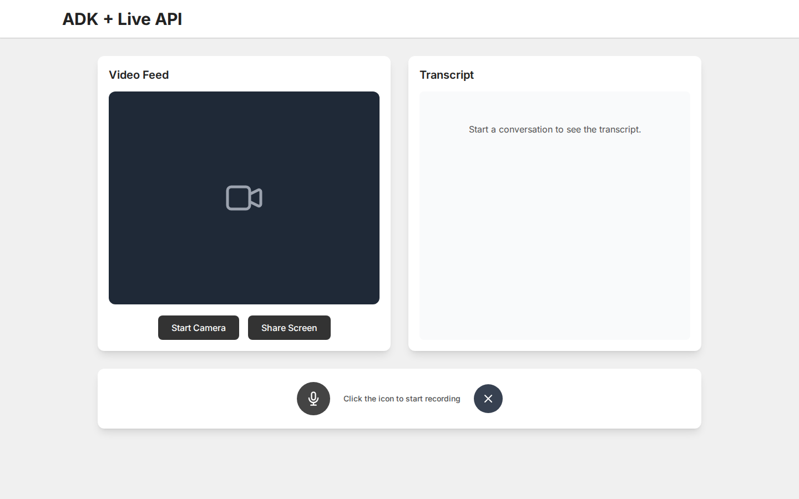

# Dara AI

Dara AI is an experimental browser-based multimodal assistant. A Python WebSocket server uses Google's Agent Development Kit (ADK) to stream audio and video to a Gemini Live model; the browser provides microphone, camera, screen-sharing, and transcript controls.



*The client in its idle state, with no server connection or conversation.*

## What is included

- Browser audio recording and playback, plus webcam or screen capture.
- A WebSocket server using ADK's `LiveRequestQueue` and `Runner`.
- An example order-status tool and Mem0 memory tools.
- Separate client and server Docker configurations and a [Cloud Run deployment guide](app/server/DEPLOYMENT.md).

This is a 2025 demo, not a maintained production integration. Its configured model is `gemini-2.0-flash-live-preview-04-09`; model availability and current ADK compatibility need to be checked before use. Google Search is imported in the server but is not registered as an agent tool in the checked-in code.

## Run locally

You need Python, a browser with microphone permissions, Google model access, and a Mem0 API key. Audio, video, and conversation data are sent to external services. Review the code and service settings before sharing sensitive information.

```bash
git clone https://github.com/MolanoJF/Dara-AI.git
cd Dara-AI
python3 -m venv .venv
source .venv/bin/activate
pip install -r app/server/requirements.txt
```

Configure ADK's Google credentials for your chosen backend. For a Gemini Developer API setup, set `GOOGLE_API_KEY`; for Vertex AI, configure application default credentials and the appropriate Google Cloud project and location. Set `MEM0_API_KEY` as well: the code constructs a Mem0 client at import time. The `PROJECT_ID` in `app/server/config/config.py` is used as the ADK agent and app name; the `VERTEX_API` flag in that file is not wired to the server's backend selection.

```bash
export GOOGLE_API_KEY=your_google_api_key
export MEM0_API_KEY=your_mem0_api_key
cd app/server
python multimodal_server_adk.py
```

In a second terminal, from the repository root:

```bash
python3 -m http.server 8000 --directory app/client
```

Open [http://localhost:8000/multimodal.html](http://localhost:8000/multimodal.html). The client connects to `ws://localhost:8765`. The frontend rendering has been checked locally; the live model and memory flows require valid external credentials and have not been verified here.

## Repository layout

- `app/client/` — HTML interface and audio/video WebSocket clients.
- `app/server/multimodal_server_adk.py` — ADK agent and streaming server.
- `app/server/agent_tools.py` and `tools/` — example tool and memory integration.
- `app/server/config/` — model, voice, and system instruction configuration.
- `app/server/DEPLOYMENT.md` — deployment notes.

The project builds on the [original ADK live API example](https://github.com/SaschaHeyer/gen-ai-livestream/tree/main/agents/agent-development-kit/live-api/app). No license file is currently included in this repository.
